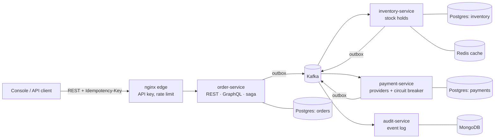

# OrderFlow

A distributed order and payment platform, written in Java 21 and Spring Boot 3. Placing an order
touches three services that each own their own data: **inventory**, **payment** and the
**order** service. There is no distributed transaction. The order saga keeps them consistent over
Kafka and undoes completed steps when a later step fails.

It is built around the problems enterprise commerce systems actually have. Clients retry. Messages
arrive twice or out of order. Two buyers race for the last unit. Payment providers time out. A
service goes down halfway through a checkout.



## The saga

```
ReserveInventory ─▶ InventoryReserved ─▶ AuthorizePayment ─▶ PaymentAuthorized ─▶ CONFIRMED
                 └▶ InventoryRejected ─▶ REJECTED        └▶ PaymentDeclined ─▶ ReleaseInventory ─▶ InventoryReleased ─▶ CANCELLED
```

The order service orchestrates. Inventory and payment each react to a command and reply with an
event. The order's status is an explicit state machine (`OrderStatus`). A late or duplicated reply
can't move an order backwards.

## What's in here and why

| Problem | How it's handled | Where |
|---|---|---|
| Client retries a POST after a timeout | `Idempotency-Key` header. The key, a SHA-256 of the body and the order commit together. A retry returns the same order. Reusing a key with a different body gets 422. | `OrderService`, `IdempotencyRecord` |
| Two identical requests at the same instant | The primary key on `idempotency_keys` decides the winner. The loser catches the violation and returns the winner's order. | `OrderService.place` |
| "Saved the order but the Kafka publish failed" (dual write) | **Transactional outbox**: the event is written in the same DB transaction as the business change, and a relay publishes it. `FOR UPDATE SKIP LOCKED` lets several replicas relay without double-sending. | `common-outbox` |
| Kafka delivers at-least-once | **Idempotent consumers**: every handler records `(consumer, event_id)` in the same transaction as its side effects. | `InboxGuard` |
| Overselling the last unit | Conditional `UPDATE … WHERE available >= :qty`. There is no read-modify-write. A test runs 200 concurrent buyers for 3 units. | `ProductRepository`, `StockConcurrencyIntegrationTest` |
| Deadlocks between multi-line orders | Product rows are always locked in SKU order. | `ReservationService` |
| Client-supplied prices | Clients send SKUs only. Inventory prices the order, so the total can't be tampered with. | `Payloads.PricedLine` |
| Money through JSON | Decimals stay `BigDecimal` end to end, never passing through a `double`. A regression test covers it. | `EventCodec` |
| Payment provider flakiness | Resilience4j Retry wraps a CircuitBreaker. The fallback sits on the outer Retry, because on the breaker it would swallow the errors Retry needs to see. The provider is called outside the DB transaction, so a slow gateway can't hold a pooled connection. | `PaymentGateway`, `PaymentService` |
| Charging twice | `UNIQUE(order_id)` on payments. A redelivered command replays the stored answer. | `PaymentService` |
| A participant is down | A saga watchdog times out stuck orders and compensates them. Release is idempotent and leaves a tombstone, so a reserve that arrives late is refused. | `SagaWatchdog`, `Reservation` |
| Poison messages | Exponential back-off, then a `<topic>.DLT` topic. Malformed JSON is never retried. | `OutboxAutoConfiguration` |
| Hot product reads | Redis cache with typed JSON serialisation, a TTL, and transaction-aware eviction. A rolled-back reservation never evicts. | `InventoryConfig` |
| Tracing one checkout | Every message carries a correlation id. The audit service stores every hop, keyed by event id, so duplicates overwrite themselves. | `audit-service` |

**Design patterns, where they earn their place:**

- **Strategy:** payment providers.
- **Factory / registry:** `PaymentProviderRegistry`.
- **Template Method:** `SimulatedProvider`.
- **State:** `OrderStatus`.
- **Facade:** `OrderEvents` and `InventoryEvents` over the outbox.
- **Sealed result types:** `AuthorizationResult`.

**APIs:**

- REST with RFC 9457 problem details, and OpenAPI at `/swagger-ui.html`.
- GraphQL read API at `/graphql`, with GraphiQL at `/graphiql`.

**Operations:**

- Actuator liveness and readiness probes.
- Prometheus metrics, with business counters such as `saga.transitions`, `outbox.published` and `payments.outcome`.
- Graceful shutdown.
- Virtual threads.

## Run it

You need Docker and nothing else.

```bash
docker compose up --build
open http://localhost:8080          # console: place orders and watch the saga
```

In the console, try these:

- **Order 4 woven cables:** only 3 are in stock, so the order is **rejected**.
- **Buy the 27 inch display with Wallet:** the payment is declined, the stock is put back, and the order is **cancelled**.
- **Press "Send the same request again":** the same order comes back, and no second order is created.
- **Select an order:** you see every command and reply, with timings.

The console also runs without the backend: open `console/index.html?demo` and the saga runs in the
browser with the same rules.

The API is also available directly:

```bash
curl -X POST localhost:8081/api/v1/orders \
  -H 'X-API-Key: local-dev-key-change-me' -H "Idempotency-Key: $(uuidgen)" \
  -H 'Content-Type: application/json' \
  -d '{"customerId":"cust-1","paymentMethod":"CARD","lines":[{"sku":"CHARGER-35W","quantity":2}]}'
```

## Tests

```bash
mvn verify          # unit tests: JUnit 5, Mockito, @WebMvcTest
mvn verify -Pit     # integration tests with Testcontainers (Postgres, Kafka); needs Docker
cd tools/loadgen && go test ./...
```

Highlights:

- `OrderSagaIntegrationTest` runs the real order service on real Postgres and Kafka, plays inventory and payment by hand, and checks the order reaches CONFIRMED.
- `StockConcurrencyIntegrationTest` proves no overselling under contention.
- `PaymentGatewayResilienceTest` proves transient failures are actually retried.
- `OrderSagaOrchestratorTest` covers compensation, duplicate replies and stale replies.

## Load test

`tools/loadgen` is a small Go CLI. It places orders at a fixed rate (open loop), re-sends a share
of requests with the same key to check idempotency under load, then follows every order to its
final state. Saga latency is measured with server timestamps (`updatedAt - createdAt`), so polling
doesn't distort it.

```bash
cd tools/loadgen
go run . -base http://localhost:8080/order -n 1500 -rate 50 -follow
```

### Results

MacBook (Apple M4), all 9 containers running locally under Docker Desktop, fresh stock for each
run, 1,500 orders per rate:

| Rate | API p99 | Saga p50 | Saga p95 | Saga p99 | Completed correctly |
|---|---|---|---|---|---|
| 25/s | 17 ms | 633 ms | 847 ms | 1.14 s | 1500 / 1500 |
| 50/s | 30 ms | 440 ms | 829 ms | 1.19 s | 1500 / 1500 |
| 75/s | 33 ms | 507 ms | 872 ms | 1.25 s | 1500 / 1500 |
| 150/s | 185 ms | 556 ms | 2.17 s | 2.39 s | 1500 / 1500 |
| 250/s | 269 ms | 2.89 s | 4.24 s | 4.67 s | 1500 / 1500 |

"Saga" is the time from order placed to its final state (confirmed, rejected or cancelled), across
all four services.

- **Latency is flat up to about 75 orders/s.** Queueing starts between 75 and 150, and at 250/s the
  system is past saturation.
- **Every order ended in a correct final state at every rate.** Under overload the saga slows down
  but never loses or double-processes an order.
- **Rejections are expected.** The load deliberately buys more than the seeded stock, so about a
  third of orders are refused with "Not enough stock". A few Wallet payments are declined, and
  their stock is returned.
- **Most of the latency at low load is outbox polling,** at 200 ms per hop. Publishing right after
  commit, or CDC (Debezium), would bring it down to tens of milliseconds.

### What tuning got it here

The first runs managed about 9 payment decisions per second. `tools/diagnose.sh` (per-stage
throughput, outbox delay, consumer lag) found three problems:

1. **Virtual threads on Java 21.** The Kafka client and parts of JDBC block inside `synchronized`
   code, which pins virtual threads to their carrier threads and starves the consumers. They're
   now off by default (`VIRTUAL_THREADS=true` to compare). JDK 24 fixes this (JEP 491).
2. **Offset commit per record.** Switched to one commit per poll batch, which is safe because every
   handler is idempotent. Concurrency is now one consumer per partition.
3. **Connection-pool starvation.** API threads could take every DB connection, and the saga
   consumers and outbox relay waited behind them. Request threads are now capped below the pool
   size (a bulkhead).

After these changes, payment throughput went from 9 to 74 decisions per second.

## Deploy

- `Dockerfile` is a single multi-stage, layered build for every service. It runs as non-root and sizes the heap to the container.
- `k8s/` is a Kustomize base plus an EKS overlay. It includes:
  - rolling updates with zero unavailable pods
  - startup, readiness and liveness probes
  - a preStop drain
  - PodDisruptionBudgets
  - zone spread
  - an HPA
  - a read-only root filesystem
  - default-deny NetworkPolicies
- In production the stateful pieces would be managed services: Aurora PostgreSQL, MSK, ElastiCache and DocumentDB or Atlas.
- `.github/workflows/ci.yml` runs in this order:
  1. unit tests
  2. Testcontainers integration tests
  3. Go vet and race tests
  4. image builds pushed to GHCR, with a build cache
  5. an EKS deploy through GitHub OIDC (no stored AWS keys), with a manual approval and a rollout check

## Trade-offs and what I'd do next

- **Orchestration over choreography.** The order's flow is in one readable class, and adding a step is local. The cost is that the order service knows every participant.
- **Polling outbox over CDC.** It's simple and has no extra infrastructure, but adds up to 200 ms of latency. Debezium tailing the WAL would remove the polling.
- **Payment after timeout.** If a payment is authorised after the watchdog has already cancelled the order, the reply is logged and counted (`saga.stale_reply`) but not refunded automatically. The next step would be a `RefundPayment` command.
- **Watchdog on several replicas.** Optimistic locking stops a double transition, but every replica still scans. ShedLock or a leader lease would make only one scan.
- **Service authentication.** It's a shared API key held at the edge. In a real deployment I'd use mTLS through a mesh, or OAuth2 client credentials with JWT validation.

## Layout

```
common-events/      event envelope + payload records (no Spring)
common-outbox/      outbox writer, relay, inbox guard, DLT handler (auto-configured)
order-service/      REST + GraphQL, idempotency, saga orchestrator, watchdog
inventory-service/  catalogue, stock reservations, Redis cache
payment-service/    provider strategies, retry + circuit breaker
audit-service/      MongoDB event log
console/            ops UI served by nginx (also the edge proxy)
tools/loadgen/      Go load generator
k8s/                Kustomize base + EKS overlay
```
